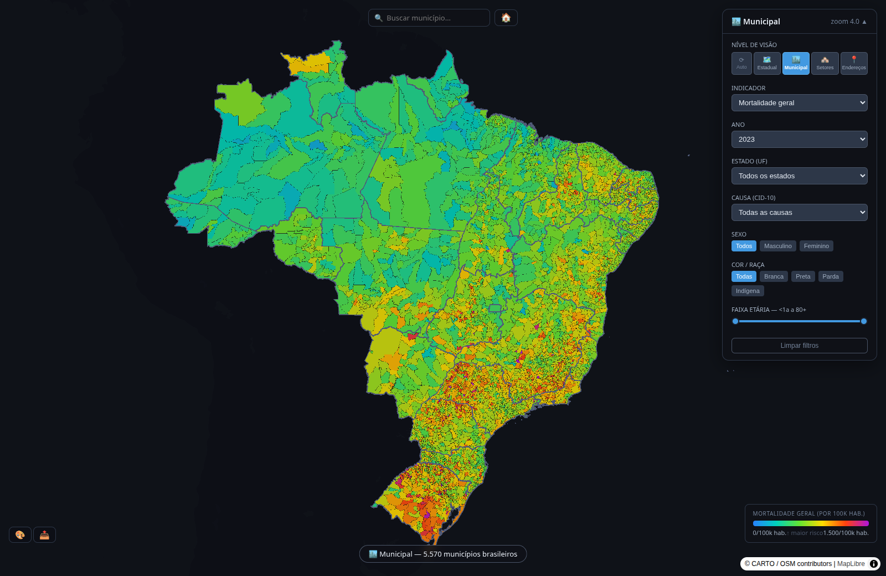
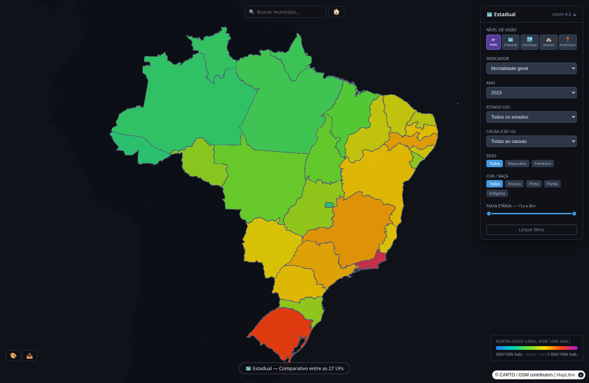

# brasil_em_dados — continental-scale geospatial panel for Brazilian public data

An interactive panel that serves **94 public indicators** for Brazil — from state level down
to **census tract** — as vector tiles generated directly from PostGIS.

**▶ Live demo: https://sevanonurb.github.io/brasil-em-dados/** — states and municipalities, all 94
indicators and every year, with no backend (see *Static demo* below for what it leaves out).



<sub>**All 5,570 municipalities at once** — general mortality per 100k inhabitants, 2023. Every polygon is served as a vector tile generated on demand from PostGIS; nothing is pre-rendered.</sub>



<sub>The same indicator at state level. The panel switches resolution — state, municipality, census tract — against the same filters: year, cause (ICD-10), sex, race and age band.</sub>

Built to answer one question well: *what does this indicator look like across the whole
country, at the finest public resolution available, without waiting for a page to load?*

---

## What it does

- **Four geographic levels**: states (`geo.ufs`), municipalities (`geo.municipios`),
  census tracts (`geo.setores_censitarios`) and subdivided tracts.
- **94 indicators** across health, education, demography, housing, economy, public finance
  and vehicle fleet — see `frontend/src/utils/metricas.js`.
- **Cross-filtering** between map, legend and detail panel.
- **Export** of the current view.
- Tiles are generated **on demand from PostGIS functions**, not pre-baked — changing the
  metric or the year re-renders without a rebuild.

## Data sources

All public, all Brazilian federal:

| source | what |
|---|---|
| **IBGE** | census (basic, housing, equipment), territorial meshes, census tracts, PPM, indicators |
| **DataSUS** | CNES, SIH, SIM, SINAN, SINASC |
| **INEP** | school census, IDEB 2005–2023 (public network, from the 2023 release that carries the whole series), educational indicators |
| **Tesouro Nacional / SICONFI** | fiscal management reports (RGF); budget execution (RREO and RREO Simplificado, 2015–2023): revenue and health/education spending per capita |
| **SENATRAN** | vehicle fleet by municipality and type, December 2015–2025 |
| **CNEFE** | national address registry |

18 loaders in `pipeline/`.

## Stack

```
PostGIS ──► pgBouncer ──► Martin (vector tiles, Rust) ──► nginx ──► React + deck.gl + MapLibre
    ▲                                                  │
    └── Dagster (orchestration)                   metadata API
                        Prometheus + Grafana (observability)
```

Frontend: **deck.gl 9.3**, **MapLibre GL 4.3**, **PMTiles 3.2**, Apache Arrow 15 + GeoArrow.

## Running it

Requires Docker and Docker Compose.

```bash
git clone <this repo> && cd brasil_em_dados
docker compose up -d
# panel at http://localhost       · Dagster at :3001 · Grafana at :3002
```

The database starts empty. Load data with the scripts in `pipeline/`, then refresh the
materialized views:

```bash
docker exec brasil_postgis psql -U brasil -d brasil_dados -c "
  REFRESH MATERIALIZED VIEW CONCURRENTLY api.indicadores_municipio;
  REFRESH MATERIALIZED VIEW CONCURRENTLY api.indicadores_uf;"
```

More commands in [`ARCHITECTURE.md`](ARCHITECTURE.md).

---

## Known limits — stated on purpose

This is an **independent build**, not a maintained product. What it does not have:

- **No unit tests.** What exists is end-to-end: a browser tester that clicks every control
  (see *End-to-end tests*) and a validator that checks the demo's in-browser mortality rates
  against the database. Dagster orchestrates the pipeline.
- **Data does not refresh by itself.** Dagster is wired in but no schedule is defined —
  loaders are run manually.
- **The metadata API is stdlib `http.server`** (`api/server.py`, 438 lines), not FastAPI.
  It works; it has no OpenAPI schema, no request validation and no auth.
- **The live demo is a subset.** It runs with no server: state and municipal levels, all 94
  indicators and years, and the mortality filters (cause / sex / race / age). Census tracts and
  CNEFE addresses need the full stack: `docker compose up postgis pgbouncer api martin frontend nginx`
  plus a data load.
- Coverage and freshness follow the upstream sources, which vary by dataset and by year.
- **Notifiable diseases (SINAN) count cases by municipality of residence**, with the Ministry of
  Health case definitions: dengue probable cases, tuberculosis and leprosy new cases, visceral
  leishmaniasis confirmed cases. Tuberculosis 2019 gives 74,212 new cases against 73,864 in the
  official bulletin. Counting raw notifications, as an earlier version did, overstated
  leishmaniasis about fivefold. Tuberculosis 2020–2023 comes from preliminary files.
- **Vehicle fleet** comes from SENATRAN's December spreadsheet by municipality and type. Municipality names
  are matched to IBGE codes, with a reviewed table for 41 old spellings, renamings and typos at the
  source (e.g. Santarém/PB is now Joca Claudino); every year matches all 5,570 municipalities and the
  summed fleet equals the spreadsheet's own total minus the "municipality not informed" rows. Trucks
  include pickups (*caminhonete*, *camioneta*); buses include minibuses.
- **Per-capita rates use the 2022 Census population for every year.** No annual municipal estimate
  is loaded, so a rate for 2015 or 2025 is measured against 2022 population.
- **Municipal debt / RCL (RGF) is noisy at the source.** Municipalities file it themselves, and
  the reported ratio and the one implied by the same filing (debt ÷ Senate limit × 120) agree
  within 0.05 pp in only 29 of 39 sampled filings (2016, 2020, 2023). The disagreements look
  like filing errors on either side (×100 slips, flipped signs, the limit typed as the ratio).
  The panel keeps the reported ratio when it is plausible, recomputes it when it is missing or
  absurd (all of 2017–2018, where the ratio is not filed), and drops values outside ±500%.
  Personnel spending / RCL is kept between 5% and 150%. Debt coverage is thin in 2017 (1,787
  municipalities): 26 of 30 sampled gaps have no debt line in either Anexo 06 or Anexo 02.

## Static demo

Geometry never changes; values do. So the demo ships the outlines once and the values separately:

| file | what |
|---|---|
| `demo/ufs.pmtiles`, `demo/municipios.pmtiles` | outlines + fixed properties, written by GDAL from `geo.*` |
| `demo/dados/<indicator>/<year>.json` | `{"m": {ibge_code: value}, "u": {state_code: value}}` |
| `demo/cubo/obitos-<year>.bin.gz` | death counts by municipality × ICD-10 chapter × sex × race × age band (SIM) |
| `demo/cubo/populacao.bin.gz` | Census 2022 population by municipality × race × sex × age band (SIDRA 9606) |

The values are extracted from **the same `api.tiles_*` functions the live panel uses**, so the demo
cannot drift from the panel — checked feature by feature on sample tiles (0 differences).
In demo mode (`VITE_DEMO=1`) `frontend/src/demo.js` answers the panel's own tile and API requests
from these files; the rest of the frontend is unchanged. Rebuild with `demo/build.sh`
(needs only `docker compose up -d postgis`).

**Mortality filters.** Every combination of cause × sex × race × age range × year is ~460k
maps (~15 GB pre-generated). The demo ships the elementary counts instead — 5.2M non-zero cells,
7.2 MB gzipped — and sums the selected subgroup in the browser with the panel's formula:
`round(deaths × 100000 / population of the same subgroup, 1)`. `demo/validar_cubo.py` compares
the browser's result with the database for seeded combinations, every municipality and state.

## End-to-end tests

`tests/e2e/testador.py` drives a real Chrome (GPU) through every control of the panel and checks each
step against an **expected result**, not just "no crash": all 302 indicator-year pairs, the 27 states,
view levels and filters, boundary values in the search and age slider, map clicks cross-checked against
the data files, axe-core accessibility, phone and desktop layouts, 300 seeded random actions, and links.
Visual oracles compare pixels: a control "worked" only if the map visibly changed, and a map where one hue
covers > 85% of the coloured area is flagged as a scale that does not match the data.

    python3 tests/e2e/testador.py [URL] [step numbers…] [--rapido]   # report: tests/e2e/relatorio/relatorio.html

## License

MIT — see [LICENSE](LICENSE).
